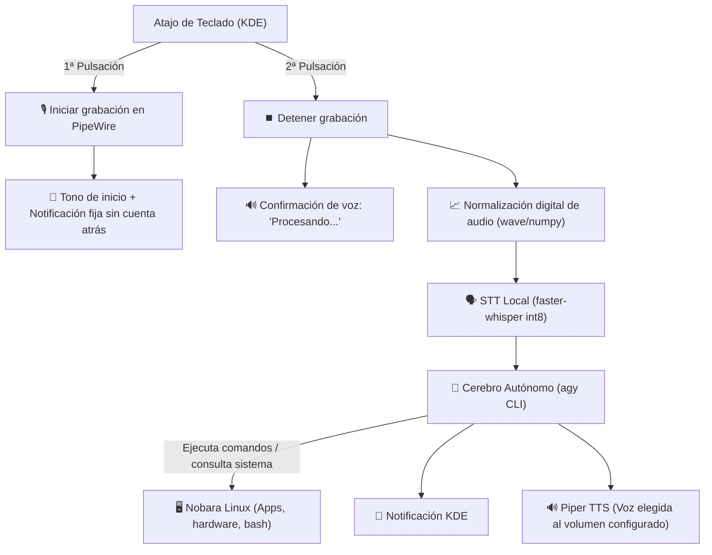

# ⚡ Jarvis AI — Nobara Linux AI Voice Assistant & Control Panel (MIT)

Asistente de inteligencia artificial personal, 100% local en reconocimiento y síntesis de voz, integrado a nivel de sistema operativo en **Nobara Linux** (KDE Plasma 6 + Wayland + PipeWire) impulsado por el CLI de **Antigravity (`agy`)**.

[](https://opensource.org/licenses/MIT)
[]()
[]()
[]()

<p align="center">
  
  <br/>
  <i>Identidad visual personalizada inspirada en el reactor Arc holográfico para KDE Plasma 6 y Wayland.</i>
</p>

---

## 🚀 Instalación Rápida (Para nuevos usuarios / amigos)

Si descargas o clonas este proyecto en un equipo nuevo:

```bash
git clone https://github.com/oscarjv233/nobara-voice-assistant.git
cd nobara-voice-assistant
./install.sh
```

El instalador automático (`install.sh`):
1. Instalará las herramientas necesarias de tu distribución (`pipewire-utils`, `libnotify`, `python3`, etc.).
2. Instalará las dependencias de Python (`faster-whisper`, `piper-tts`, `PySide6`, `numpy`).
3. Descargará los modelos de voz en español si no existen.
4. Si no tienes **Antigravity (`agy`)**, lo descargará e instalará automáticamente.
5. Creará los accesos directos y te guiará para asignar el atajo de voz en KDE Plasma.

> [!IMPORTANT]
> **Inicio de sesión personal en Antigravity (`agy`):**
> Cada usuario debe autenticarse con su propia cuenta de Google. Si es la primera vez que usas Antigravity, simplemente abre un terminal y escribe:
> ```bash
> agy
> ```
> Sigue el enlace en pantalla para iniciar sesión con tu cuenta de Google. A partir de ese momento, el asistente de voz funcionará vinculado a tu cuenta personal.

---

## 📑 Índice de Contenidos

1. [Visión y Arquitectura General](#1-visión-y-arquitectura-general)
2. [Estructura del Proyecto y Archivos](#2-estructura-del-proyecto-y-archivos)
3. [Componentes Técnicos en Profundidad](#3-componentes-técnicos-en-profundidad)
   - [A. Captura de Audio Nativa (PipeWire)](#a-captura-de-audio-nativa-pipewire)
   - [B. Reconocimiento de Voz Local (faster-whisper)](#b-reconocimiento-de-voz-local-faster-whisper)
   - [C. Cerebro y Continuidad de Sesión (Antigravity agy)](#c-cerebro-autónomo-y-continuidad-de-sesión-antigravity-agy--agent_runner)
   - [D. Síntesis de Voz Neural (Piper TTS)](#d-síntesis-de-voz-neural-piper-tts)
   - [E. Panel Gráfico de Control e Historial (PySide6 / Qt6)](#e-panel-gráfico-de-control-e-historial-pyside6--qt6)
4. [Control de Volumen Independiente](#4-control-de-volumen-independiente)
5. [Guía de Voces y Cómo Añadir Más](#5-guía-de-voces-y-cómo-añadir-más)
6. [Configuración del Atajo en KDE Plasma 6](#6-configuración-del-atajo-en-kde-plasma-6)
7. [Problemas Resueltos y Lecciones Técnicas](#7-problemas-resueltos-y-lecciones-técnicas)
8. [Comandos de Mantenimiento y Pruebas](#8-comandos-de-mantenimiento-y-pruebas)

---

## 1. Visión y Arquitectura General

El objetivo del proyecto es tener un asistente de voz fluido, privado y con control total del sistema sin depender de APIs de pago ni enviar grabaciones de voz a servidores externos:



---

## 2. Estructura del Proyecto y Archivos

El proyecto reside de forma autocontenida en `~/nobara-voice-assistant/`:

```
nobara-voice-assistant/
├── run.sh                             # Lanzador rápido de la app o asistente
├── install.sh                         # Instalador automático para cualquier máquina
├── LICENSE                            # Licencia libre MIT
├── README.md                          # Documentación completa
├── assets/                            # Recursos gráficos e identidades visuales
│   ├── nobara-jarvis.svg              # Vector SVG del reactor Arc holográfico
│   ├── nobara-jarvis-*.png            # Iconos rasterizados (48, 64, 128, 256) para FreeDesktop
│   └── generate_icons.py              # Generador automático de assets PNG
├── bin/
│   ├── nobara-voice-assistant         # Script ejecutable principal (gestión de estados toggle)
│   ├── nobara-voice-assistant-settings# Lanzador de la aplicación gráfica de ajustes
│   ├── nobara-voice-assistant-tray    # Lanzador de la bandeja del sistema (System Tray)
│   ├── nobara-voice-assistant-silence # Atajo de pánico para silenciar audio inmediatamente
│   ├── nobara-voice-assistant-wakeword# Controlador del demonio Wake Word manos libres
│   └── nobara-voice-assistant-hud     # Lanzador de la cápsula flotante en pantalla (Overlay HUD)
├── src/
│   ├── fast_path.py                   # Comandos rápidos (<30ms): volumen, multimedia MPRIS y hardware
│   ├── recorder.py                    # Grabador inteligente PipeWire con detección de fin de frase (Auto-Stop VAD)
│   ├── transcribe.py                  # Motor STT: faster-whisper con ganancia adaptativa
│   ├── speak.py                       # Motor TTS: Piper neural, Audio Ducking y volumen de stream
│   ├── agent_runner.py                # Ejecutor de AGY con streaming live, monitor de tareas y memoria de sesión
│   ├── conversations.py               # Parser de transcripciones de brain e historial de conversaciones
│   ├── settings_gui.py                # Panel de control gráfico en PySide6 con 2 pestañas (Voz + Historial/Monitor)
│   ├── tray.py                        # App nativa para la bandeja del sistema de KDE Plasma 6
│   ├── wakeword.py                    # Detección continua de palabras clave ("Hey Jarvis", "Alexa")
│   └── overlay_hud.py                 # Ventana flotante estilo Dynamic Island translúcida
├── voices/
│   ├── es_ES-davefx-medium.onnx       # Voz: Hombre (España - DaveFX)
│   ├── es_ES-sharvard-medium.onnx     # Voz: Mujer (spk 1) y Hombre (spk 0) (España - Sharvard)
│   ├── es_AR-daniela-high.onnx        # Voz: Mujer (Español Neutro/Natural - Daniela High)
│   ├── en_US-lessac-medium.onnx       # Voz: Mujer (Inglés US - Lessac Medium)
│   ├── en_US-ryan-medium.onnx         # Voz: Hombre (Inglés US - Ryan Medium)
│   └── procesando.wav                 # Audio pre-renderizado de confirmación inmediata
├── desktop/
│   ├── nobara-voice-assistant.desktop # Acceso para atajos globales de KDE Plasma
│   ├── nobara-voice-assistant-settings.desktop # Acceso al panel de control en el menú de inicio
│   ├── nobara-voice-assistant-tray.desktop # Acceso e inicio automático de la bandeja
│   └── nobara-voice-assistant-silence.desktop # Acceso para el atajo de silenciar voz
├── config/
│   └── config.env                     # Variables de configuración persistentes
├── install.sh                         # Instalador automático para cualquier máquina
└── README.md                          # Este documento
```

---

## 3. Componentes Técnicos en Profundidad

### A. Captura de Audio Nativa y Detección de Fin de Frase (PipeWire + Auto-Stop VAD)
- Utiliza la herramienta oficial `pw-record` conectada al nodo de entrada por defecto (micrófono USB Trust GXT 232).
- Parámetros: `--rate 16000 --channels 1 --format s16` (formato ideal para modelos Whisper).
- Manejo de procesos: Guarda el PID en `/tmp/nobara_assistant.pid`. Al pulsar de nuevo, envía `kill -SIGINT` para que se cierre el contenedor WAV con sus cabeceras correctas.
- **Detección Automática de Silencio Inteligente (Auto-Stop VAD - Opcional):**
  - Implementado en [src/recorder.py](file:///home/oscar/nobara-voice-assistant/src/recorder.py).
  - Mide la energía RMS en trozos de 50ms, calibra dinámicamente el ruido ambiental base en los primeros 250ms y filtra ruidos impulsivos de tecleo.
  - Al callarte durante el tiempo configurado (por defecto 1.2s), corta la grabación y lanza el procesamiento de inmediato sin necesidad de volver a pulsar el teclado.
  - **🔒 Privacidad Garantizada:** Esta función es 100% opcional desde el panel de control. El micrófono **NUNCA** escucha en segundo plano de manera continua; únicamente empieza a escuchar al pulsar tu atajo de teclado, y se apaga automáticamente al detectar silencio. Si lo prefieres desactivado, el modo manual clásico (pulsar para hablar, pulsar para enviar) sigue funcionando intacto.

### B. Reconocimiento de Voz Local (faster-whisper)
- Implementado en [src/transcribe.py](file:///home/oscar/nobara-voice-assistant/src/transcribe.py).
- **Lectura directa con `wave` y `numpy`:** Evita dependencias rotas de `pyav` y lee el audio en milisegundos.
- **Normalización Digital de Volumen:** Escala la amplitud del micrófono al 92% para que las voces suaves o micrófonos lejanos se entiendan al 100%.
- **Anti-Alucinaciones:** Configurado con `condition_on_previous_text=False` y `compression_ratio_threshold=2.4` para evitar bucles repetitivos si hay zumbido de fondo.

### C. Cerebro Autónomo y Continuidad de Sesión (Antigravity agy + agent_runner)
- Implementado en [src/agent_runner.py](file:///home/oscar/nobara-voice-assistant/src/agent_runner.py).
- **Modo Conversación Continua:** Reutiliza la misma conversación de AGY (`--conversation <ACTIVE_ID>`) entre órdenes consecutivas para mantener el hilo de trabajo o proyecto.
- **Detección de Reinicio por Voz:** Si el usuario dice frases como *"nueva conversación"*, *"empezar de cero"* o *"reinicia el contexto"*, limpia la sesión al instante en 0.05s y arranca una conversación limpia.
- **Visualización en Pantalla (KDE Plasma 6 / Wayland):**
  - Exporta `DISPLAY=:0` y `WAYLAND_DISPLAY=wayland-0`.
  - Si el usuario pide *ver*, *mostrar* o *abrir* algo en pantalla, abre ventanas VISIBLES mediante `kstart --` (o `kstart -- konsole --separate -e ...` para herramientas interactivas como htop/btop) sin enviarlas a segundo plano oculto.
- **Monitor en Vivo y Notificaciones en Streaming:**
  - Emplea `--output-format stream-json` para leer los pasos del agente en directo.
  - Actualiza la notificación de escritorio (`notify-send -r`) mientras se ejecuta cada comando para informar en tiempo real.
  - Guarda el estado en `/tmp/nobara_assistant_live.json` con PID, comandos en curso y tiempos.

### D. Síntesis de Voz Neural (Piper TTS)
- Implementado en [src/speak.py](file:///home/oscar/nobara-voice-assistant/src/speak.py).
- **Limpieza de Markdown:** Filtra asteriscos (`**`), tildes graves (`` ` ``) o códigos para que la voz no lea símbolos de formato.
- Genera el audio temporalmente en `/tmp/nobara_assistant_speech.wav` y lo reproduce inmediatamente a través de PipeWire.

### E. Panel Gráfico de Control e Historial (PySide6 / Qt6)
- Implementado en [src/settings_gui.py](file:///home/oscar/nobara-voice-assistant/src/settings_gui.py).
- **Instancia Única (Single-Instance IPC via QLocalServer):** Al hacer clic en el icono de Jarvis en el panel o lanzarlo desde el menú, se comunica por un socket local con la app en ejecución, desminimizando y trayendo la ventana al frente en KDE Plasma 6 (`requestActivate()`) sin crear ventanas duplicadas.
- **Pestaña 1 (Ajustes de Voz & Hardware):** Tarjetas amplias con scroll fluido (`QScrollArea`), selector de voces Piper con botón de prueba, control de volumen de flujo independiente, modelos Whisper, Auto-Stop VAD con calibración de segundos, interruptor de Audio Ducking, sensibilidad de Wake Word y conmutador de cápsula HUD.
- **Pestaña 2 (Memoria Neural y Sesiones AGY):**
  - **Cabecera Glassmorphic:** Visualizador del ID de sesión activa en badge cian con botón para copiarlo (`📋`), switch de memoria de contexto continuo y botón de acción rápida `➕ Nueva Sesión Limpia`.
  - **Monitor en Vivo Plegable:** Permanece completamente oculto en reposo para dejar el 100% de la pantalla libre, desplegándose automáticamente cuando Jarvis ejecuta una tarea para mostrar progreso y el botón `🛑 Detener Tarea`.
  - **Buscador Reactivo:** Campo `🔍 Buscar en historial...` que filtra conversaciones instantáneamente por palabra clave o comando.
  - **Drawer de Sesiones:** Tarjetas con fecha, contador de turnos (`🎯 N turnos`), etiqueta `⭐ [ACTIVA]` y menú contextual con clic derecho (retomar, copiar ID, exportar Markdown o borrar).
  - **Visor Estilo Chat Moderno:** Burbujas diferenciadas para el usuario (`👤 TÚ`), terminales monospace para herramientas del sistema ejecutadas (`⚙️ pactl`, `run_command`) y respuestas formateadas de `⚡ JARVIS AI` con soporte para Markdown, bloques de código con sintaxis resaltada y botones de acción rápida.

### F. Comandos Multimedia y Sistema Instantáneos ("Fast Path" en <30ms) ⚡
- Implementado en [src/fast_path.py](file:///home/oscar/nobara-voice-assistant/src/fast_path.py).
- Evalúa localmente frases comunes antes de invocar a la IA, respondiendo en **menos de 30 milisegundos**:
  - **Control de Música (MPRIS / Spotify / Navegador):** *"pausa la música"*, *"siguiente canción"*, *"canción anterior"*, *"reanuda la música"*.
  - **Volumen y Audio (PipeWire wpctl):** *"sube el volumen"*, *"baja el volumen"*, *"volumen al 70%"*, *"silencia el audio"*, *"silencia el micrófono"*.
  - **Estado Gamer y Hardware Nobara:** *"¿cómo va la gráfica?"*, *"temperatura de la gráfica/CPU"*. Consulta instantáneamente `sensors` y canta los grados y estado.
  - **Sistema:** *"bloquea la pantalla"*, *"¿qué hora es?"*, *"¿qué día es hoy?"*.
- Si la frase es compleja o requiere razonamiento, viaja a Antigravity AGY con toda su potencia.

### G. Icono en la Bandeja del Sistema (KDE Plasma 6 System Tray) 🎛️
- Implementado en [src/tray.py](file:///home/oscar/nobara-voice-assistant/src/tray.py).
- Se integra en la barra junto al reloj con el icono Arc-Reactor y estados visuales:
  - 🟢 **Normal / Verde**: En reposo (Idle).
  - 🔴 **Rojo**: Grabando voz del micrófono (Recording).
  - 🔵 **Azul**: Procesando o ejecutando orden (Thinking).
- **Menú rápido con clic derecho**: Hablar/grabar, iniciar nueva conversación, alternar idioma (Español/English), conmutar voz TTS, conmutar Modo Gaming, silenciar audio y abrir panel de ajustes.
- Clic izquierdo o doble clic abre el panel de control.

### H. Modo Gaming y Audio Ducking 🎮
- Implementado en [src/speak.py](file:///home/oscar/nobara-voice-assistant/src/speak.py).
- Cuando el asistente comienza a hablar, **reduce automáticamente el volumen de tu juego o Discord al 45%** mediante PipeWire y, al terminar la frase, restaura suavemente el volumen original al 100%. Nunca te perderás una respuesta aunque estés jugando.

### I. Activación Manos Libres (Wake Word "Hey Jarvis") 🗣️
- Implementado en [src/wakeword.py](file:///home/oscar/nobara-voice-assistant/src/wakeword.py).
- Impulsado por **openWakeWord** con modelos ONNX 100% locales (*"Hey Jarvis"*, *"Alexa"*, *"Hey Mycroft"*).
- **Carga de Modelo Exclusivo:** Carga únicamente la red neuronal seleccionada en memoria, reduciendo el consumo de CPU a menos del 1.2% (ideal para no impactar FPS en juegos).
- **Ganancia Digital Adaptativa:** Multiplica automáticamente la amplitud de micrófonos USB de bajo volumen para asegurar una activación precisa sin tener que gritar.
- **Deslizador de Sensibilidad:** Ajustable entre Alta (0.20), Normal (0.30) y Estricta (0.45).
- Emite un tono acústico inmediato (*bell chime*) al activarse para avisar que Jarvis está escuchando.

### J. Cápsula Flotante en Pantalla (Overlay HUD / Dynamic Island) 🔮
- Implementado en [src/overlay_hud.py](file:///home/oscar/nobara-voice-assistant/src/overlay_hud.py).
- Cápsula translúcida semitransparente con esquinas redondeadas en la parte superior central de la pantalla:
  - Onda de sonido animada en directo mientras hablas.
  - Indicador de estado neon mientras procesa.
  - Muestra la transcripción y el resultado de la tarea.
  - **No roba el foco del teclado ni del ratón (`Qt.WindowDoesNotAcceptFocus`)**, permitiéndote seguir jugando o escribiendo sin interrupciones.
  - **Cerrojo Mutex Kernel (`fcntl.flock`):** Garantiza que nunca se rendericen ventanas HUD duplicadas en pantalla.

### K. Botón de Pánico y Silenciado Inmediato 🛑
- Ejecutable dedicado: `nobara-voice-assistant-silence` (atajo rápido de escritorio disponible).
- Si el asistente está leyendo un texto largo y necesitas que pare de golpe (o entra una llamada), silencia la voz en 0.05s y retira la notificación.

---

## 4. Control de Volumen Independiente

Para evitar alterar el volumen maestro de Nobara:
- Se utiliza la opción de flujo de PipeWire: `pw-play --volume=<VALOR>`.
- El valor se define entre `0.05` y `1.0` en `config.env` (por defecto `0.35` = 35%).
- **El volumen general de tus auriculares, juegos o Discord se mantiene totalmente intacto.**

---

## 5. Guía de Voces y Cómo Añadir Más

Las voces se encuentran en el directorio `voices/` en formato ONNX. Actualmente disponibles:

| Nombre en la App | Archivo ONNX | Orador (Speaker) | Características |
| :--- | :--- | :--- | :--- |
| **Hombre - España (DaveFX)** | `es_ES-davefx-medium.onnx` | *Por defecto* | Masculina, acento de España. |
| **Mujer - España (Sharvard F)** | `es_ES-sharvard-medium.onnx` | `1` | Femenina, acento de España. |
| **Hombre - España (Sharvard M)** | `es_ES-sharvard-medium.onnx` | `0` | Masculina alternativa. |
| **Mujer - Natural (Daniela High)** | `es_AR-daniela-high.onnx` | *Por defecto* | Femenina, alta definición y fluidez. |
| **Woman - English US (Lessac Medium)** | `en_US-lessac-medium.onnx` | *Por defecto EN* | Femenina en inglés estadounidense, clara y natural. |
| **Man - English US (Ryan Medium)** | `en_US-ryan-medium.onnx` | *Por defecto EN* | Masculina en inglés estadounidense, tono profundo. |

### ¿Cómo añadir más voces de Piper en el futuro?
1. Descarga el modelo `.onnx` y su `.onnx.json` desde el repositorio oficial de [HuggingFace rhasspy/piper-voices](https://huggingface.co/rhasspy/piper-voices).
2. Guárdalos en la carpeta `voices/` del proyecto.
3. Añade la entrada en la lista `AVAILABLE_VOICES` dentro de `src/settings_gui.py`.

---

## 6. Configuración del Atajo en KDE Plasma 6

En sistemas en inglés (Nobara KDE Plasma 6):

1. Abre **System Settings** ➔ **Shortcuts**.
2. Pulsa en **Add New** (abajo a la izquierda) ➔ Selecciona **Application...**.
3. Busca **"AI Voice Assistant"** y selecciónalo.
4. Pulsa en **Add shortcut**, presiona tu combinación preferida (ej: **`Meta + Space`** o **`F9`**).
5. Pulsa **Apply**.

---

## 7. Problemas Resueltos y Lecciones Técnicas

1. **Resolución de Enlaces Simbólicos (`readlink -f`):**
   - *Problema:* Al llamar al script mediante el symlink `~/.local/bin/nobara-voice-assistant`, `dirname "${BASH_SOURCE[0]}"` apuntaba a `~/.local/bin` en vez de a la carpeta del proyecto, fallando al buscar los módulos de Python.
   - *Solución:* Se usó `SCRIPT_PATH="$(readlink -f "${BASH_SOURCE[0]}")"` para resolver siempre la ubicación física real.
2. **Heredado de Descriptores de Fichero en `flock`:**
   - *Problema:* El proceso en segundo plano de `pw-record` heredaba el descriptor del cerrojo (fd 200), bloqueando la segunda pulsación.
   - *Solución:* Se cierran los descriptores con `200>&-` al lanzar subprocesos en background y se libera el cerrojo explícitamente (`flock -u 200`).
3. **Cortes de Voz por VAD agresivo:**
   - *Problema:* Silero VAD descartaba palabras cortas o habladas suavemente.
   - *Solución:* Se desactivó `vad_filter` y se añadió normalización de ganancia previa por software al 92% de pico.
4. **Reemplazo de Notificación en KDE:**
   - *Problema:* Se generaban múltiples burbujas y una barra de cuenta atrás generaba prisa al usuario.
   - *Solución:* Se utiliza `notify-send -p` y `notify-send -r <ID> -t 0` para tener una única notificación persistente que muta según el estado.
5. **Instancia Única en KDE Plasma 6 / Wayland (IPC Socket):**
   - *Problema:* Al pulsar repetidamente el icono de la app en la barra o en el lanzador, se creaban ventanas duplicadas.
   - *Solución:* Implementación de `QLocalServer` y `QLocalSocket`. La nueva llamada despierta a la ventana existente con `showNormal()`, `raise_()`, `activateWindow()` y `windowHandle().requestActivate()`, saliendo inmediatamente sin abrir clones.
6. **Prevención de Ventanas Flotantes Duplicadas (HUD Overlay Mutex):**
   - *Problema:* Al recargar ajustes o iniciar el HUD por distintas vías, podían aparecer dos cápsulas visuales solapadas.
   - *Solución:* Cerrojo a nivel de kernel con `fcntl.flock` no bloqueante en `/tmp/nobara_assistant_hud.lock`.
7. **Baja Amplitud y Mapeo en Redes de Wake Word (openWakeWord):**
   - *Problema:* Micrófonos USB con baja ganancia entregaban muestras débiles que openWakeWord no detectaba, y los nombres de claves devueltos por ONNX incluían sufijos de versión (`hey_jarvis_v0.1`) que rompían la comparación estricta.
   - *Solución:* Ganancia adaptativa en tiempo real por software, coincidencia por palabra clave normalizada y carga de modelo dedicada reduciendo CPU a <1.2%.

---

## 8. Comandos de Mantenimiento y Pruebas

- **Abrir Panel de Ajustes:**
  ```bash
  nobara-voice-assistant-settings
  ```
- **Probar el Asistente desde la Terminal:**
  ```bash
  nobara-voice-assistant
  ```
- **Reinstalar o refrescar enlaces:**
  ```bash
  ./install.sh
  ```
